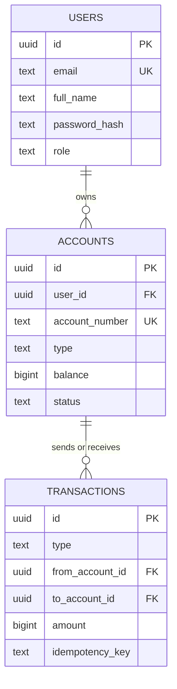

# Architecture

## Database schema

Money is stored as integer paise in `BIGINT` columns. The database enforces non-negative balances, positive amounts, and valid transaction shapes with `CHECK` constraints.
