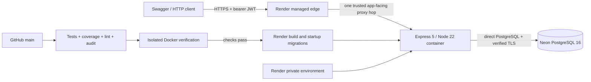
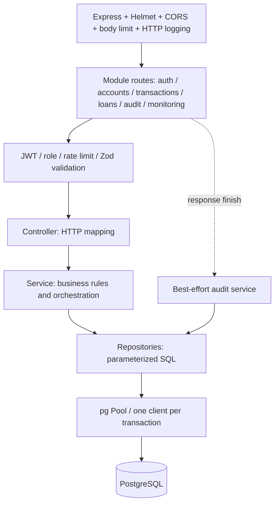
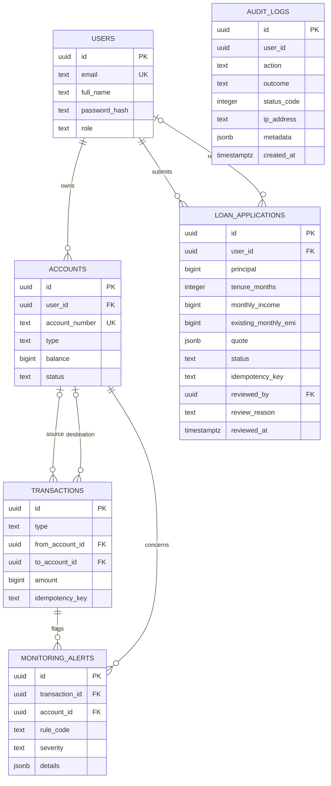

# Architecture

An educational **modular monolith**, not microservices, a payment processor or a full
double-entry general ledger. One Node.js process serves all API modules. PostgreSQL is
the source of truth; no browser may connect to it directly.

## Deployment and trust boundaries



Render hosts a free Singapore web service; Neon hosts a separate free Singapore project.
The runtime is non-root. The local Compose runtime additionally enforces a read-only
filesystem/dropped capabilities; those Compose controls must **not** be assumed to be
Render's container settings. The image excludes `.env`, source tests, host dependencies
and Git history. The bootstrap validates configuration, applies migrations on a direct
connection, then `exec`s Node. Database credentials/JWT signing secret are private runtime
configuration, not frontend configuration or build artifacts.

`TRUST_PROXY=1` assumes Render's app-facing topology; adding another proxy/CDN requires
review. CORS denies unlisted browser origins in production, but is not authentication or
a firewall. Same-origin Swagger is public and sends real requests. Limits are per process;
there is no shared Redis limiter or cross-instance coordination.

## Request and module boundaries



The exact middleware order is route-specific (for example, audit hooks wrap limiter and
validation failures). `src/modules/index.js` composes routes; `src/app.js` configures the
application; `src/server.js` owns listening/signals/shutdown. Modules expose services and
repository operations rather than letting controllers issue SQL. Deliberate exceptions
are operator scripts, migrations, database health queries and test fixtures.

| Module       | Responsibility                                   | Important boundary                                               |
| ------------ | ------------------------------------------------ | ---------------------------------------------------------------- |
| auth         | Register/login, bcrypt, HS256 JWT, current user  | Signing secret never leaves the API; role grant is operator-only |
| accounts     | Account creation and owner-scoped reads/locks    | An unrelated account looks absent (404)                          |
| transactions | Deposits, withdrawals, transfers and history     | One DB transaction for balances, ledger and monitoring           |
| loans        | Exact quote, saved applications and admin review | Approval is a decision, not disbursement; no self-review         |
| audit        | Selected request outcomes and admin listing      | Post-response writes, append-only trigger, not durable delivery  |
| monitoring   | Large-transaction/rapid-transfer alerts          | Writes share the money transaction; admin-only reads             |

## Database schema



Diagram fields are abbreviated; the five SQL migrations are authoritative. `audit_logs.user_id`
is deliberately **not** a foreign key, so historical audit entries do not depend on a
user's continued existence. `pgmigrations` is migrator bookkeeping, not a business table.

Money is integer paise in `BIGINT`, converted to JSON numbers only within JavaScript's
safe-integer range. Database checks enforce nonnegative balances, positive amounts and
valid deposit/withdrawal/transfer shapes. Unique keys enforce:

- Case-insensitive user emails and unique account numbers.
- Transaction retries scoped by `(COALESCE(from_account_id, to_account_id), idempotency_key)`.
- Application retries scoped by `(user_id, idempotency_key)`.
- At most one alert per transaction/rule pair.

Application quotes are stored JSONB snapshots. Reviews conditionally update a pending
row, enforce a different reviewer/applicant, and keep a customer-visible reason. Audit
row update/delete is blocked by a trigger, but a privileged DB operator can bypass it.

## Transfer: atomicity and retry safety

```mermaid
sequenceDiagram
  participant C as Client
  participant S as Transaction service
  participant R as Repositories
  participant P as PostgreSQL client
  C->>S: Validated transfer + user + Idempotency-Key
  S->>P: BEGIN (one checked-out connection)
  S->>R: Resolve destination account number
  S->>R: Lock both accounts in ascending ID order
  R->>P: SELECT FOR UPDATE (source is owner-scoped)
  S->>R: Look up prior key on source account
  alt Matching completed request exists
    S->>P: COMMIT without another movement
    S-->>C: Original transaction + current account + replay header
  else New request
    S->>S: Active accounts, sufficient funds, safe bounds
    S->>R: Debit, credit, insert ledger row, record monitoring
    R->>P: All statements use the same transaction client
    S->>P: COMMIT
    S-->>C: 201 (only after commit)
  end
  Note over S,P: Any failure rolls back; client is released in finally
```

Sorting locks reduces opposite-direction transfer deadlocks. Ownership precedes replay;
replay precedes current business-state checks. Reusing a key for changed normalized input
returns 422. A transfer has one transaction row referenced from both accounts; this is
not a full accounting ledger with independently balanced debit/credit postings.

History uses opaque keyset cursors with microsecond timestamps and UUID tie-breakers.
Counterparty account numbers are masked. Offset pagination and browser date reformatting
must not be substituted for those cursors.

## Failure and lifecycle boundaries

- SQL/money/monitoring failure: roll back the whole money movement, not partial balances.
- Audit delivery failure: log it, do not rewrite a successful response; crash loss remains.
- SIGTERM: stop accepting HTTP, drain pending audit writes, end the pool, exit. A hard
  provider deadline can still interrupt cleanup.
- Idle managed DB disconnect: handle the pool error; do not blindly retry a money write.
- Bad environment or migration: Render startup fails before HTTP. Applied migrations are
  skipped on restart. Code rollback does not automatically reverse schema/data changes.
- Free-tier sleep/quota: availability may be delayed; no SLA, HA or verified backup/restore
  guarantee. The project is for disposable demonstration data only.

See [security review](security-review.md), [demo walkthrough](demo.md) and
[deployment runbook](day-23.md) for evidence and accepted limitations.
